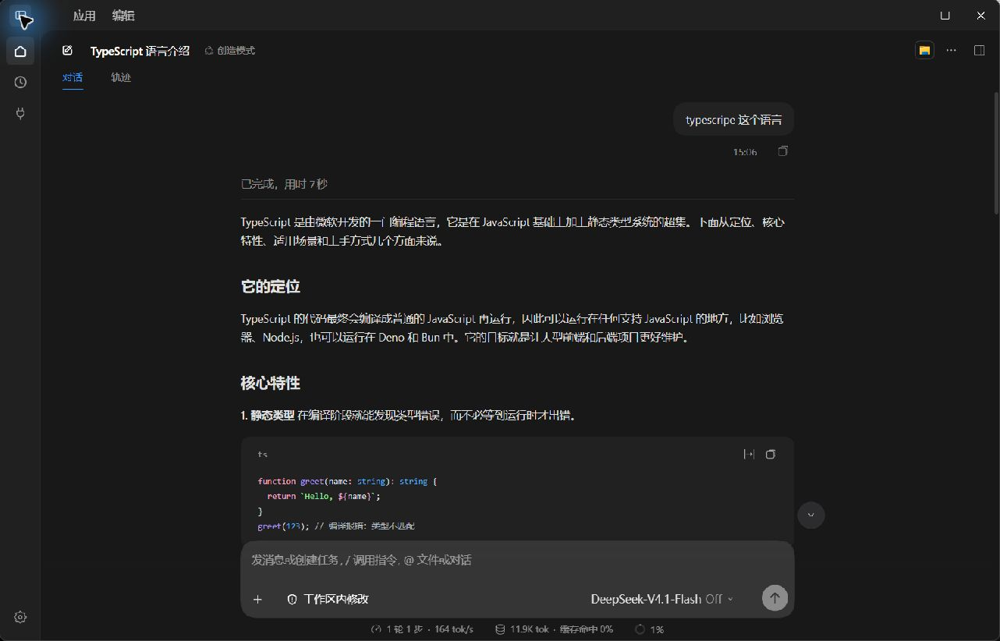
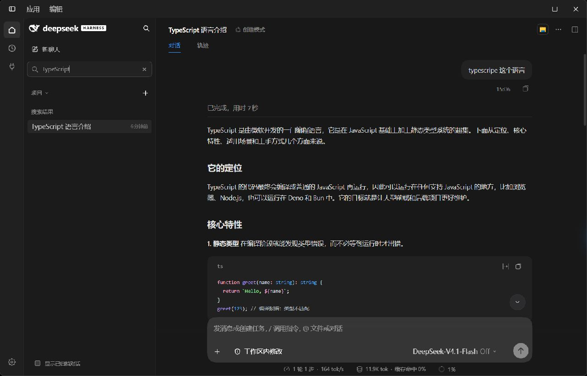
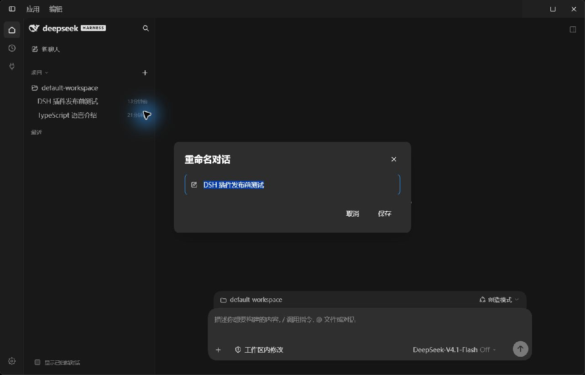
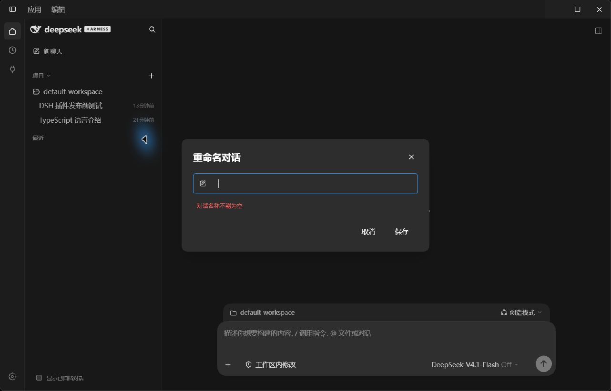
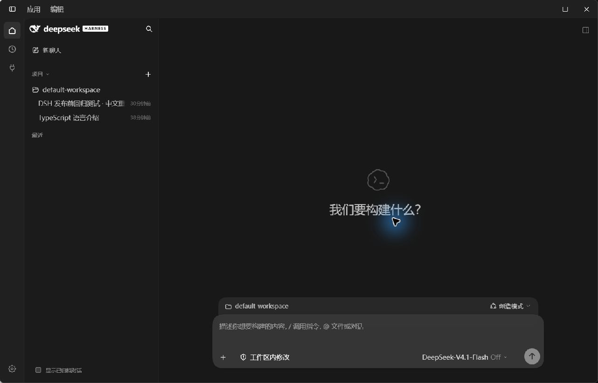

# Windows DSH 0.2.1-rc.2 测试记录

日期：2026-10-24。环境：Windows x64、官方 DeepSeek Harness 0.2.1-rc.2、Node.js 24.21.0。

测试对象为 0.1.3 源码及 PR #1 的修复；修复提交为 `2e0ed290a44b6d7c88fb70e93d5af51741be9d64`，随后合入 `d00cd234dd8f4c1dd30bf28ca6f491483908842e`。此记录不表示 npm 上的 0.1.3 已包含修复；本次未发布 npm。

## 自动化检查

```powershell
npm run build
npm test
node --check lib/client.js
node --check lib/host.js
git diff --check
```

安装器测试已随 PR #1 合入 `scripts/test-install.mjs`，在临时 profile 中运行，不改动日常 DSH 配置。7 项检查全部通过：

| 检查 | 结果 |
|---|---|
| 有锁文件：安装、同版本重复安装、两阶段回退 | 通过 |
| 无锁文件且缺少 dependencies：安装、重复安装、回退 | 通过 |
| 官方 Windows 默认程序目录发现，无锁文件 | 通过 |
| DSH_RUNTIME_FILE 显式指定自定义运行时 | 通过 |
| 版本不匹配时拒绝写入 profile | 通过 |
| 显式运行时不存在时拒绝静默切换到其他安装 | 通过 |
| 回退遇到用户后续修改时拒绝覆盖 | 通过 |

重复安装覆盖的是同版本，不等同于跨版本升级。Windows 自动目录发现用例在非 Windows 环境中跳过。

## 真实宿主交互

| 功能 | 操作与观察 | 结果 |
|---|---|---|
| 插件加载 | 详情页显示 0.1.3、1 个组件运行中 | 通过 |
| 侧栏 | 展开、收起，待动画结束检查布局 | 通过 |
| 搜索无结果 | 输入随机不匹配关键词，显示“没有匹配的对话” | 通过 |
| 搜索命中 | 输入 TypeScript，保留匹配标题的会话 | 通过 |
| 消息发送 | 专用测试会话中输入、发送真实任务，收到结果 | 通过 |
| 文件工具 | 读取真实 package.json；写入专用 result.txt 并重读；另从文件系统核对标记和版本 | 通过 |
| 工具失败展示 | 工作区外写入先被沙箱拒绝，界面显示失败 | 通过 |
| 审批链路 | 展示审批原因及等待状态；用户手动处理审批后任务继续完成 | 通过 |
| Markdown | 结果表格、JSON 代码块及文件改动卡片正常显示 | 通过 |
| 置顶 | 测试会话移至置顶分组，取消后回项目树 | 通过 |
| 归档恢复 | 归档测试会话；显示已归档并展开项目；取消归档后按钮恢复 | 通过 |
| 更新查询 | 当前、最新均为 0.1.3，结果注明 npm 官方源 | 通过 |
| 本机安装更新 | 修复脚本自动识别官方安装目录，无锁文件也安装成功，保留备份及回退入口 | 通过 |
| 中文重命名 | 保存中文名称后侧栏更新；再次打开回读一致 | 通过 |
| 取消重命名 | 修改输入后点击取消，原名称不变 | 通过 |
| 空名称 | 提交空白名称时留在表单并显示校验错误 | 通过 |

权限审批由用户手动处理；自动化未点击权限按钮。只归档、恢复、置顶和改名专用测试会话，没有删除用户会话或真实项目。

## 两项问题与修复验证

1. 原重命名先报 `prompt() is not supported.`。改用插件内表单后发现 `ctx.sessions.rename` 不存在，最终改为宿主 `sessions.using(...reference.binding.session.rename(title))`。中文保存、回读、取消已验证；错误会留在表单内显示。
2. 原安装脚本要求旧数据目录内 runtime.json 和 profile 锁文件，在本机官方 Windows 安装中失败。修复后自动发现默认程序安装目录，并保留无锁文件状态；上述隔离检查与真实安装更新通过。

## 重命名复现步骤

使用专用测试会话：右键 → 重命名 → 输入中文 → 保存；确认侧栏标题更新，再次打开检查输入值。随后改为另一个名称并取消，确认原值不变。最后提交纯空白，确认显示“对话名称不能为空”。

## 截图证据

以下均为真实运行截图，未做界面重绘。侧栏与搜索截图来自修复前的同一 0.1.3 基线，重命名截图来自修复验证阶段；取消后名称不变以侧栏状态为证。

### 侧栏折叠


### 标题搜索命中


### 插件内重命名表单


### 空名称校验


### 中文名称保存成功


### 取消后原名称保持不变


## 未完整覆盖的范围

市场原生安装与卸载重装、跨版本升级、长期运行与停止取消、项目增删改、分叉实际创建、附件、模型切换和 Max、全部键盘/输入法边界、不同分辨率和缩放、断网回退、24 小时自动更新周期及发现新版提醒均未完整验收。不能将本记录解读为全部功能或全部平台通过。
